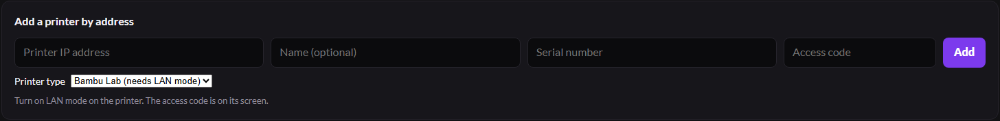

<!--
LICENSE

Copyright (C) 2026  sterling motuz <Sterling@dexabyte.ca>

for https://github.com/printer-buddy/printer-buddy

SPDX-License-Identifier: AGPL-3.0-only

Additional term (AGPL-3.0 section 7b, keep author credit): keep this header

Additional term (AGPL-3.0 section 7c, mark changed versions): if you make any changes, you must include a CHANGELOG with all changes and their dates
-->
# Install

There are two ways to install Printer Buddy. Either way it talks to your printers over the network (Klipper printers through Moonraker, Bambu Lab and Elegoo printers directly), and the install steps are the same.

=== "On a printer"

    Install it on the printer's own Klipper host (the Pi or board running Klipper and Moonraker).

    **Good for:** one printer, or a small setup where you don't want a dedicated host.

    **You need:**

    - A printer running Klipper + Moonraker on Debian-based Linux (most Pi-based printers, MainsailOS, FluiddPi…)
    - SSH access to it, plus `git` and `python3`

    **Good to know:**

    - The installer adds `printer-buddy` to Moonraker's service list, so you can restart it from Fluidd or Mainsail too.
    - Port 8080 is often taken by the printer's webcam &mdash; the installer then offers the next free port.
    - Keep it light: AI **basic** at most.

=== "On a dedicated host"

    Install it on a dedicated host on the same network as your printers &mdash; a Raspberry Pi, a NAS, a home server or an old PC.

    **Good for:** several printers, AI **heavy**, timelapses of every printer, or cameras plugged into the host.

    **You need:**

    - A host running Debian-based Linux (Raspberry Pi OS **64-bit**, Debian, Ubuntu…)
    - `git` and `python3` (the installer adds `python3-venv` if it's missing)
    - Printers on the same network: Klipper + Moonraker, Bambu Lab, or Elegoo Centauri Carbon (CC1 or CC2) (see [supported printers](../coming-soon.md#more-printers))

!!! tip "AI on 32-bit"
    The **basic** and **heavy** AI models need a 64-bit system (`aarch64` or `x86_64`); on a Pi, use Raspberry Pi OS (64-bit). The **lite** model and everything else work on 32-bit too.

## Install it

Same for both: SSH in and run

```bash
git clone https://github.com/printer-buddy/printer-buddy.git
cd printer-buddy
./install.sh
```

The first time you run it, the installer welcomes you and walks through the setup choices one at a time, from **Step 1 of 7** to **Step 7 of 7** (see [Install choices](choices.md)). Enter keeps the suggested answer for any step. At the end it asks **Install Printer Buddy now? [Y/n]**.

After that, every run opens a menu. Pick **1) Install** to install or reinstall, **2) Change setup** to change a choice, and so on. To install with no questions, keeping your current setup (or the defaults on a first install):

```bash
./install.sh -y
```

It sets up a Python environment, downloads the parts you picked, creates the `printer-buddy` service and starts it. When it's done it prints the address, usually:

```
http://<its-ip>:8080
```

## Adding printers

1. Open Printer Buddy and click **Scan network**. It checks your local network for Moonraker (ports 7125 and 80, plus Moonraker's own network announcement). It only *lists* printers &mdash; it doesn't connect to any yet.
2. Tick the printers you want and click **Add selected**.
3. If a printer's Moonraker has login turned on, enter its **API key** when asked.

Printer not found? Use **Add by IP** and type its address (and port, if it isn't 7125).

Not a Klipper printer? In **Add by IP**, pick the **Printer type**:

- **Bambu Lab (needs LAN mode)**: its IP address, **Serial number** and **Access code** (on the printer's screen).
- **Elegoo Centauri Carbon**: only its IP address. Printer Buddy finds the rest. Tick **OpenCentauri patched firmware** if it runs that ([more](../printers/elegoo.md#opencentauri)).
- **Elegoo Centauri Carbon 2**: its IP address, **Serial number** and **Access code** (on the printer's screen), with LAN mode on.

A printer running OpenCentauri COSMOS is added as **Klipper (Moonraker)**.



## Port

Printer Buddy uses port **8080**. If something else already has it (often the webcam streamer on Klipper boxes), the installer says what's using it and offers the next free port.

Change it later with **P) Change port** in the installer menu, or:

```bash
./install.sh -y --port 8090
```
