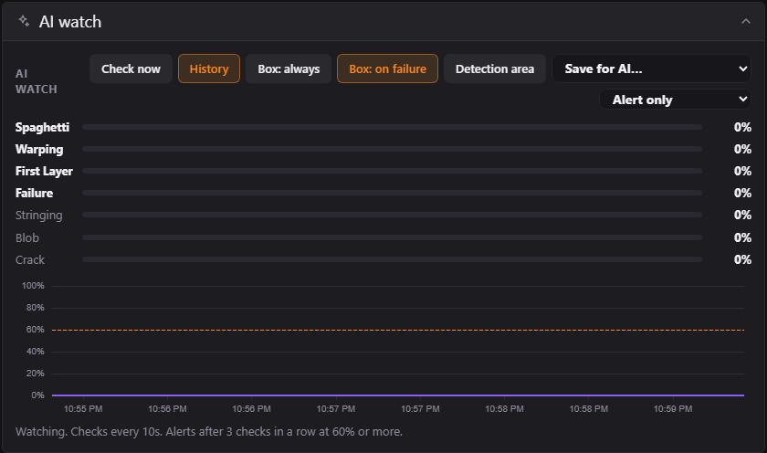
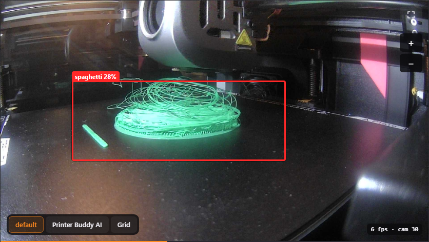

<!--
LICENSE

Copyright (C) 2026  sterling motuz <Sterling@dexabyte.ca>

for https://github.com/printer-buddy/printer-buddy

SPDX-License-Identifier: AGPL-3.0-only

Additional term (AGPL-3.0 section 7b, keep author credit): keep this header

Additional term (AGPL-3.0 section 7c, mark changed versions): if you make any changes, you must include a CHANGELOG with all changes and their dates
-->
# AI failure detection

Printer Buddy's own models look at the printer's camera during prints and score how likely each problem is.

## What it looks for

Spaghetti, warping, first-layer problems, stringing, blobs, cracks and other failures.

Spaghetti, warping, first-layer problems and other failures trigger alerts (and auto-pause, if it's on). Stringing, blobs and cracks are only shown as warnings.

## Models

| Model | Runs on | Notes |
|---|---|---|
| **lite** | Any host, 32-bit or 64-bit, very little memory | The smallest model, a bit less accurate. Runs without the AI libraries the others need |
| **basic** | A Raspberry Pi (64-bit) | Pick this on a Pi |
| **heavy** | A strong PC or a GPU | The most accurate |

!!! note "64-bit for basic and heavy"
    **basic** and **heavy** need a 64-bit system (Raspberry Pi OS 64-bit, or any x86_64 PC). **lite** runs on 32-bit systems too.

!!! note "NVIDIA GPU"
    **heavy** can use an NVIDIA GPU. If the host has a working NVIDIA driver (`nvidia-smi` works), the installer sets up the GPU version of the AI libraries. The GPU also needs NVIDIA's CUDA and cuDNN libraries installed on the host; without them it runs on the CPU. **Settings → AI** shows what the model runs on.

Pick one with **AI detection** in the installer, or switch it later in the **Updates** list (home page ☰). Every model release is tested on the same 1,000 photos; the scores are in each release's notes under **Model check**. With the v1.5 models, basic is right 93% of the time and catches 91% of failures; heavy is right 95% of the time with only 3% false alarms.

## When it alerts

It checks the camera every few seconds while a printer prints, and only alerts after **several checks in a row** look bad, so one odd frame doesn't set it off. Change these in the home page's **Settings → AI**, or on a printer's **Settings** tab under **AI Detection**:

| Setting | Choices | Default |
|---|---|---|
| Alert when a problem scores at least | 40-80% | 60% |
| Check the camera every | 5, 10, 20, 30 s | 10 s |
| …for this many checks in a row | 1, 2, 3, 5 | 3 |
| Then wait before alerting again | 5, 10, 20, 30 min | 10 min |

Higher threshold or more checks in a row = fewer false alarms, but a failure is caught a little later.

Per printer (AI watch on the printer page) you choose **Alert only**, **Alert + auto-pause** or **Off**.

## The failure box

When the AI thinks something's wrong, a red box on the camera shows where. **Box: on failure** (default) only works it out when a failure is likely; **Box: always** draws it on every check (uses more CPU). Turn both off to save CPU on older Pis.

## Score history

Click **History** in the AI watch section to see a chart of the highest problem score from each check during the current print. The dashed line is your alert threshold, and a red line marks each alert. It keeps up to 4,320 checks per print (12 hours at the default 10 s).

## Detection area

By default the AI looks at the whole picture. To make it ignore clutter around the bed, click **Detection area** in the AI watch section and drag a box over the camera picture. **Clear area** goes back to the whole picture.

## Helping train it

- When it alerts, answer **Was it really a failure?** &mdash; false alarms are the most useful.
- **Save for AI…** saves the current camera view with a label.
- **Settings → AI** shows saved photos and how often the AI was right on your printers. Turn on **Help improve the AI** to send labelled photos for training.

**Nothing leaves your box** unless you turn on **Help improve the AI**. If you do:

- only **labelled** photos are sent, one at a time, at most 50 a day
- each is shrunk to 640 px and re-saved, so no location or camera details
- sent with your **box number** (the random ID in your share links), the label, how bad it was, and what the AI scored at the time; **not** your name, address or printer list (your internet address is only used to count the daily limit for 2 days and is never stored with the photo)
- they go to a **private** dataset used only to train Printer Buddy's AI models
- once sent, the photo is deleted from your box; turn it off any time and nothing more is sent

Photos show whatever your printer camera sees, so keep people and private things out of its view.
