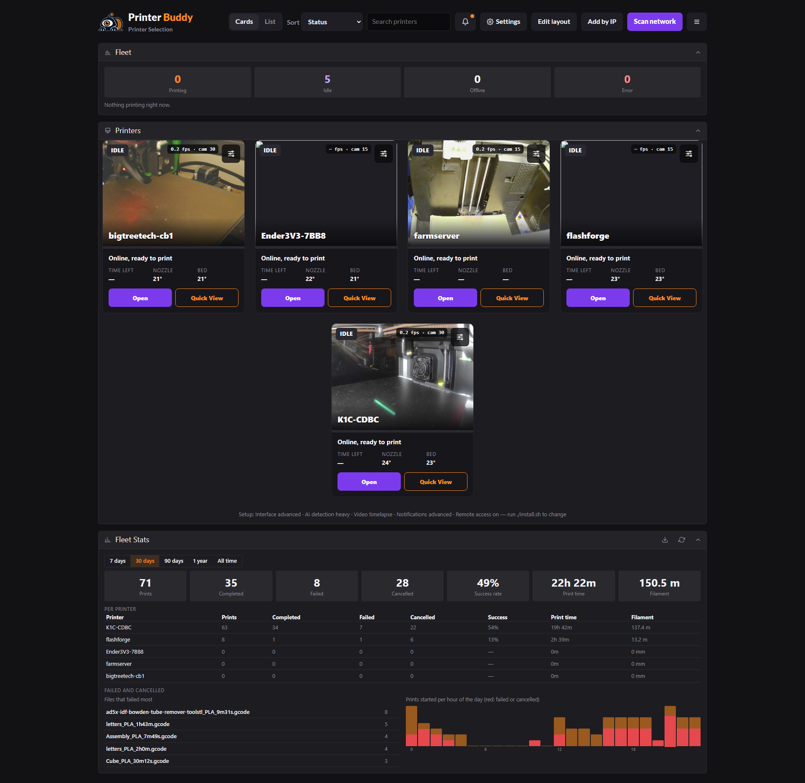
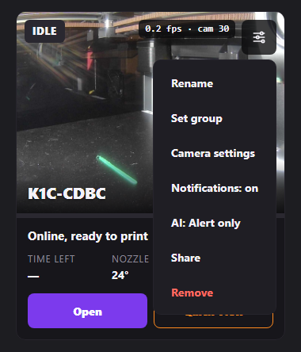

<!--
LICENSE

Copyright (C) 2026  sterling motuz <Sterling@dexabyte.ca>

for https://github.com/printer-buddy/printer-buddy

SPDX-License-Identifier: AGPL-3.0-only

Additional term (AGPL-3.0 section 7b, keep author credit): keep this header

Additional term (AGPL-3.0 section 7c, mark changed versions): if you make any changes, you must include a CHANGELOG with all changes and their dates
-->
# Home page

The home page shows every printer you've added.

## Printer cards

Each card shows the printer's state (printing, paused, idle, offline, error), the file, progress, time left, nozzle and bed temperatures and the camera. Its **Open** button opens the [printer page](printer-page.md), and **Quick View** opens it in a pop-up.

## Views and sorting

- **Sort** by status, name, progress or your own order (drag the cards; advanced interface).
- **Search** to filter by name.
- **List view** and **groups** (advanced interface) for lots of printers.

## Quick View

**Quick View** on a card opens the printer in a pop-up without leaving the home page &mdash; handy for a quick look at the camera and progress.

## Fleet Stats

The **Fleet Stats** panel adds up every printer's print history for the last 7, 30 or 90 days, a year, or all time:

- **Prints**, **Completed**, **Failed**, **Cancelled**, **Success rate**, **Print time** and **Filament**.
- A table with the same numbers for each printer.
- **Failed and cancelled**: the files that failed most, and a chart of prints started per hour of the day with the failed part in red.
- The download button saves the prints in the chosen time range as a CSV file.

A printer that's offline isn't counted; the panel says which.

## Editing the layout

**Edit layout** lets you add, move, resize and remove panels on the home page, the same way as on printer pages.

## Top bar

- **News** (bell) &mdash; Printer Buddy news and notices from your printers (like Moonraker warnings).
- **Settings** &mdash; alerts, AI, look and about.
- **☰** &mdash; the [Printer Buddy drawer](drawers.md): restart, host power, services and updates.
- **Add by IP** and **Scan network** &mdash; add printers.
