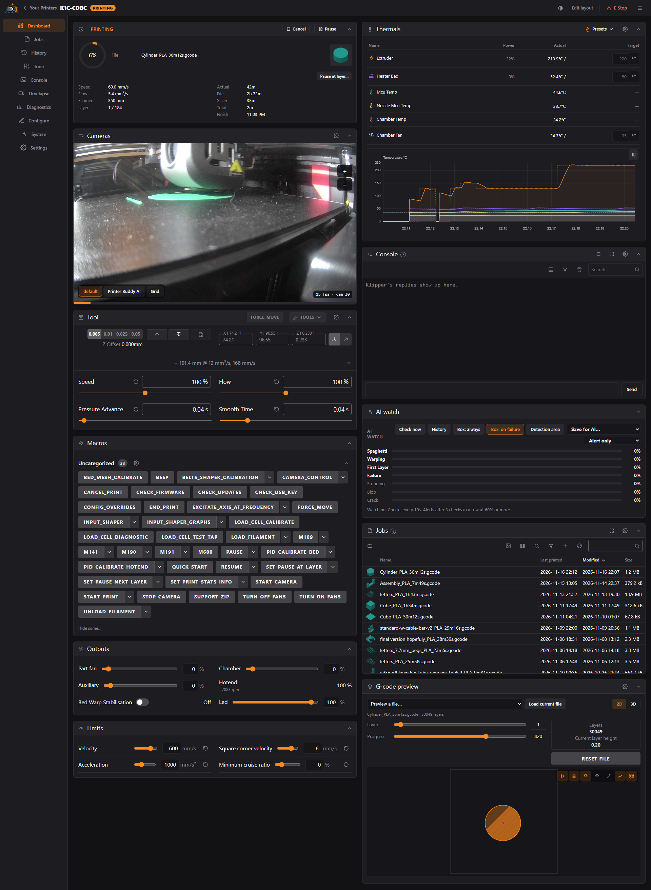
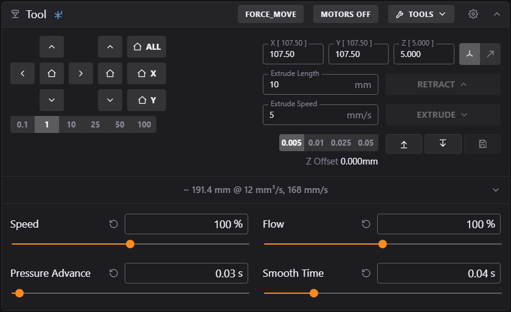
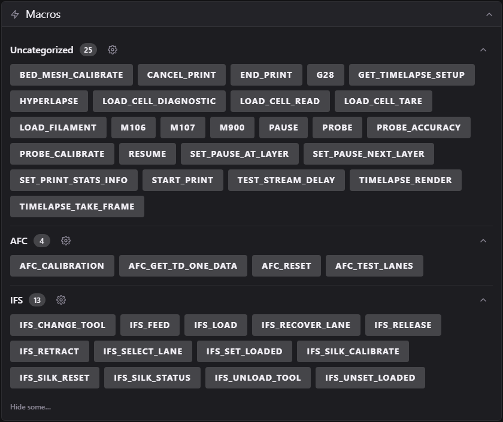
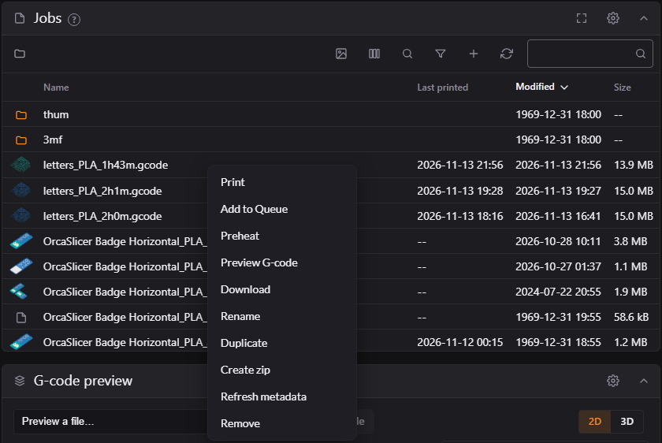
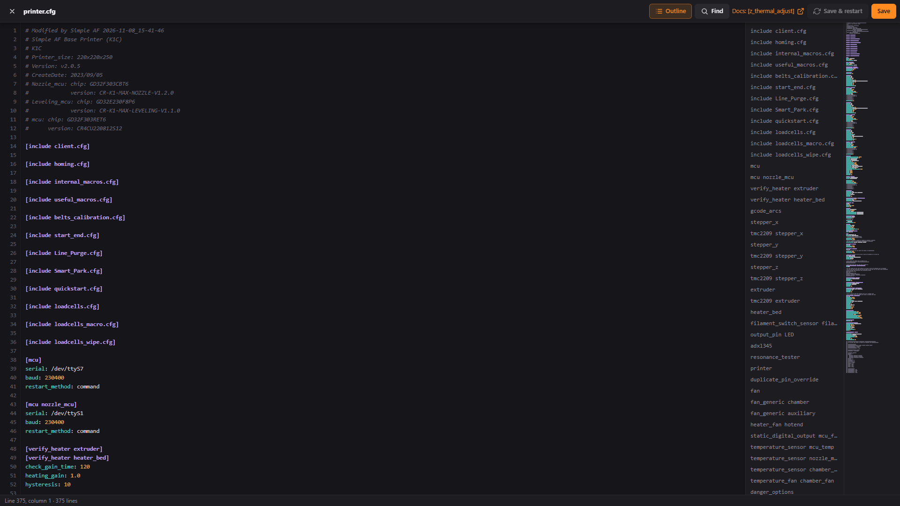
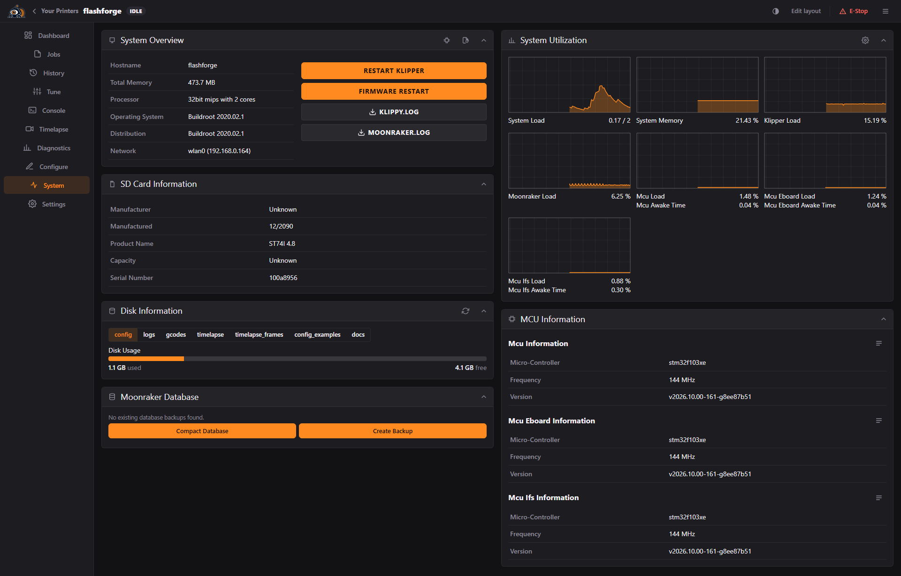
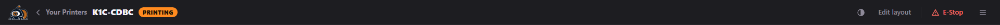

<!--
LICENSE

Copyright (C) 2026  sterling motuz <Sterling@dexabyte.ca>

for https://github.com/printer-buddy/printer-buddy

SPDX-License-Identifier: AGPL-3.0-only

Additional term (AGPL-3.0 section 7b, keep author credit): keep this header

Additional term (AGPL-3.0 section 7c, mark changed versions): if you make any changes, you must include a CHANGELOG with all changes and their dates
-->
# Printer page

Press **Open** on a printer's card on the home page to open its page. It's laid out like Fluidd, so if you know Fluidd you know where things are.

## Tabs and panels

The sidebar on the left holds the page's tabs. Each tab is made of panels.

| Tab | What's on it |
|---|---|
| **Dashboard** | Status, spools, camera, tool, macros, outputs, limits, thermals, console, jobs, G-code preview, AI watch |
| **Jobs** | The full Jobs file list, and the queue when something is queued |
| **History** | Statistics and every past print |
| **Tune** | Bed mesh, bed mesh controls, end stops, runout sensors, Beacon |
| **Console** | The console, full page |
| **Timelapse** | Timelapse videos, status and settings |
| **Diagnostics** | Live charts of Klipper values, sensors, and a viewer for every Klipper object |
| **Configure** | Config files and the editor |
| **System** | The printer's computer, disks, database, load charts and MCUs |
| **Settings** | Settings for the page and every panel |

- **Edit layout** (top bar) lets you add, move and remove panels and tabs, and drag tabs to reorder them.
- **Collapse** at the bottom of the sidebar shrinks it to icons.

## Camera

The camera panel shows the printer's main camera. Use the buttons in its top-right corner:

- **Full screen** &mdash; fills the screen. Press the same button, or Esc, to leave.
- **+ and &minus;** &mdash; zoom in and out, up to 8 times. You can also scroll the mouse wheel over the picture to zoom towards the cursor, or double-click to zoom to 2.5 times and double-click again to go back.
- **Moving around** &mdash; when you're zoomed in, drag the picture. On a touch screen, drag with one finger and pinch with two.
- **The zoom button** (for example **2.5&times;**) appears while you're zoomed in. Click it to go back to normal. Switching camera or printer also resets the zoom.

It's a digital zoom: the page enlarges the picture the camera sends, so you don't get more detail than the camera gives you.

## Tool

Moving and extruding, like Fluidd's Tool card.

- **Arrows** move X, Y and Z by the distance picked under them. **Home** buttons home all axes, X and Y, X, Y or Z.
- **Position fields** show where the toolhead is. Type a value to move there; the button next to them switches between absolute and relative moves.
- **Extrude length** and **speed**, then **Retract** or **Extrude**. The line under them shows how much filament that is and how fast.
- **Z offset** with its step sizes, and a button to save it.
- **Speed**, **Flow**, **Pressure advance** and **Smooth time** sliders. The arrow next to each puts it back to the printer's own value.
- **FORCE_MOVE** only shows when `[force_move]` is in your config. It asks before turning it on.
- **Tools** has **Load filament**, **Unload filament**, **Clean nozzle**, **Park toolhead** and calibration commands.
- **Motors off** shows when the printer is ready and homed. It asks first, and the axes need homing again after.

Jog distances, speeds and inverted axes are in **Settings &rarr; Tool**.

## Macros

The macros panel shows each of your printer's macros as a button, in groups.

- **Click a macro** to run it. A macro that takes values has a small arrow next to it: click the arrow to open a box with a field for each value, then **Send**. The name button runs it without values.
- **Hide some&hellip;** shows an &times; on each button so you can hide the ones you never use. **Show hidden** brings them back.
- **The gear** on a group's heading opens **Organize**, where you put macros in groups you name, such as Calibration or Camera. The arrow on the heading folds the group. Macros without a group are under **Uncategorized**.
- **Suggest groups** (in **Organize**) sorts macros that aren't in a group yet, by their names, into Print, Calibration, Motion, Filament, Temperature, Camera, Lights and System. Macros that share a first word, such as `MMU_LOAD` and `MMU_UNLOAD`, go in a group named after it. Macros you've already grouped stay where they are.
- **Lock** (in **Organize**) greys a macro out while a print is running or paused. An unlocked macro still asks you to confirm when you run it during a print.

Groups, locks and hidden macros are saved in your browser, for each printer.

## Jobs

The Jobs panel lists the G-code files on the printer, like Fluidd's Jobs card.

- **Click a column heading** to sort by name, last printed, modified or size. The column button picks which columns show.
- **Click a file** for its menu: **Print**, **Add to Queue**, **Preheat**, **Edit** or **View**, **Preview G-code**, **Download**, **Rename**, **Duplicate**, **Create zip**, **Refresh metadata** and **Remove** (some only show for files they apply to). Click a folder to open it.
- The toolbar has thumbnail size, columns, **go to file**, a filter, **+** to upload or make a folder, refresh, and a search box.

## Job queue

The queue panel lines up prints to run one after another. Add files with **Add to Queue** in the Jobs panel. For each file you can set how many copies to print (**&minus;** and **+**), move it to the front with **&uarr; Next**, or remove it. **Resume** and **Pause** control when the next job starts.

Under the list it adds up the queue: **Filament** (metres and grams), **Print time** and **ETA**, the time the whole queue should finish. If a print is running, the ETA includes what's left of it. If some files have no estimate in them, a note says how many.

On the Jobs tab the queue only shows when something is queued.

## G-code preview

Shows a print file layer by layer, in 2D or 3D.

- **Load current file** loads the file that's printing; the menu next to it picks any file.
- **Layer** and **Progress** sliders step through the layers and through one layer. **Reset file** clears it.
- The buttons over the picture turn on and off: follow the print, the previous, current and next layer, moves, extrusions, and **objects**.
- **Objects** draws each object of the print on the bed, if your slicer labels objects and `[exclude_object]` is in your config. While printing, click an object's &times; to skip it for the rest of the print. It asks first.

## Tune

- **Bed Mesh** draws the mesh. **Calibrate** probes a new one. Switch between the mesh and the probed points, flat or 3D, and the grid lines.
- **Bed Mesh Controls** lists your saved profiles: load or remove one, **Save as&hellip;**, **Clear**, and **Manual probe**.
- **End Stops** shows whether each end stop is open or triggered. Press the refresh button to check again.
- **Runout Sensors** shows whether filament is detected, with a switch to turn each sensor on or off.
- **Beacon** only shows on a printer with a Beacon probe: load, save or remove models, and **Calibrate**.

A manual probe (from **Manual probe** or Z calibration) opens a box where you step the nozzle down until a sheet of paper just drags, then **Accept**.

**Bed screws** opens its own box: turn the screw it names, then press **Adjusted**, or **Accept** when it's right. **Abort** stops.

## MMU and AMS

The MMU / AMS panel shows the filament slots, which one is loaded, and lets you load and unload (Happy Hare, AFC, Bambu AMS). With AFC (Box Turtle, Night Owl…) each unit shows its lanes, with colour, material and how much is left; clicking a lane loads it. On a Creality K2 it shows the CFS units and their slots, with colours and humidity; load and unload stay on the printer.

## Console

Type G-code and press **Send**.

- **↑ / ↓** go through the commands you've sent. **Tab** completes a command or macro name.
- Start typing to get suggestions for every command and macro Klipper knows.
- The toolbar has **search**, **filters** (hide lines you don't care about, like temperature reports), **clear**, and a button that puts the newest lines at the top instead of the bottom.
- **?** next to the title shows the console's keys when you hover over it.
- Type `help` to open a searchable list of every command.
- Click a line you sent to put it back in the box.

## History

- **Statistics** adds up the printer's history: total jobs, longest job, total and average time, print time and filament. The cog shows time in days and length in kilometres; the bin resets the statistics (the list stays).
- **History** lists every print. Search it, pick columns, **Load all**, **Remove all** (it asks first), download it as CSV, open **Charts** and **Maintenance reminders**, and click a print for its details, notes and **Reprint**.

## Configure

**Config files** lists the printer's config folder. The menu at the top switches to **Config examples** or **Docs**, which you can only view.

- **Click a file** to open it in the editor. Images open in a viewer.
- **Right-click a file or folder** for **Edit**, **Rename**, **Duplicate**, **Download**, **Create zip** and **Delete**. Delete asks first.
- **+ Add** makes a new file or folder, or uploads files or a whole folder. The toolbar also has a search box, **Filter**, **Go to file** and refresh. You can also drag files onto the list, and drag a file onto a folder to move it.
- Tick several files to zip or delete them together.

### The editor

The editor opens full screen, with the file's name at the top and **● unsaved** when you have changes.

- **Outline** lists every `[section]` in the file; click one to jump to it. Turn it off in the panel's settings.
- **The minimap** on the right shows the whole file shrunk down. Click it to jump, or drag the grey band to scroll.
- **Find** (Ctrl+F) searches the file, with **Replace** and **All** to replace the matches, and **Aa** to match capitals.
- **Docs: [section]** opens Klipper's Config Reference for the section the cursor is in.
- **Save** (Ctrl+S) saves the file. **Save &amp; restart** saves it and restarts Klipper, or Moonraker for Moonraker's files. It asks first and is off while printing.
- **Tab** puts in two spaces. **Esc** or **&times;** closes the editor, and asks first if you have unsaved changes.

The outline and the minimap are hidden on small screens.

## System

- **System Overview** shows the printer's computer (hostname, OS, CPU, memory, network) with **Restart Klipper**, **Firmware Restart** and the log downloads. Its buttons open **Devices** (serial, USB, CAN and camera IDs) and roll the logs over.
- **SD Card Information** and **Disk Information** (used and free space for each folder).
- **Moonraker Database** backs up and restores Moonraker's database, which holds your print history, spools and saved settings. Restoring replaces everything, so it asks first, and it's off while printing. **Compact Database** shrinks the file.
- **System Utilization** has small charts of system load, memory, Klipper, Moonraker and each MCU. They fill in while the page is open.
- **MCU Information** shows each board's chip, speed and firmware version.

## Settings

General, Theme, Notifications, AI Detection, Console, File Browser, Macros, Cameras, Plate Check, Tool, Thermal Presets, Gcode Preview, Updates, Other Card Options, Machine, Devices and About, plus every panel's own options in one place.

### Plate check

Warns you before printing on top of something left on the bed.

1. Clear the bed, then press **Take it now** under **Settings &rarr; Plate Check** to save the empty-bed picture.
2. When you start a print from Printer Buddy, the start box compares the camera with that picture and says whether the bed looks empty. You can still print anyway.

**Sensitivity** sets how much has to change. **Test now** checks it straight away. It only checks prints started from Printer Buddy, needs a camera that sees the bed, and needs a new picture if the camera or light changes a lot.

## Top bar

| Button | What it does |
|---|---|
| **Save config** | Only shows when Klipper has unsaved changes &mdash; see below |
| Theme | Switches between auto (follows your system), light and dark |
| **Edit layout** | Add, move and remove panels and tabs |
| **E-Stop** | Stops the printer immediately |
| **☰** | The [printer drawer](drawers.md): restarts, host power, services |

**Pause** and **Cancel** are on the **Printer Status** panel, at the top of the Dashboard.

## Errors and warnings

When Klipper isn't ready, a **Klippy** card at the top of the page shows its state (for example **Klippy: shutdown**), Klipper's own message in red, and buttons for **Restart Klipper**, **Firmware Restart** and the `klippy.log` and `moonraker.log` downloads.

When there are **warnings** &mdash; deprecated config options, a Moonraker plugin that failed to start, or on a Bambu printer its own notices (like "The AMS filament ran out") &mdash; they're listed in yellow on the same card.

When Printer Buddy can't reach the printer at all, the page shows the printer's address and **No Moonraker connection**, with **Force refresh**. Printer Buddy keeps trying in the background.

A Bambu printer's errors show in words, such as "The nozzle is clogged. (0300_4006)", instead of a bare number.

## Save config

After a calibration, bed mesh, offset or anything else Klipper hasn't saved yet, an orange **Save config** button appears. Click it to see exactly what will be written to `printer.cfg`, then **Save config & restart** (runs `SAVE_CONFIG`, which restarts Klipper). It's disabled while printing.
